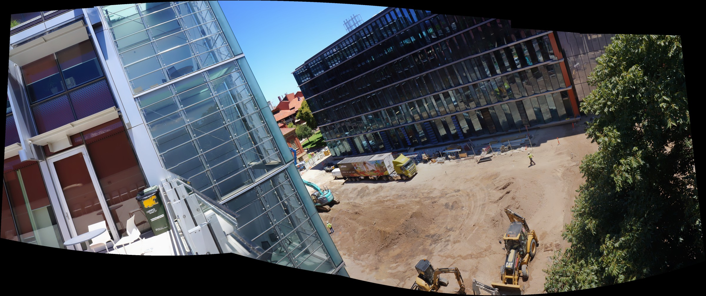

# Panorama Stitcher

A Python tool that stitches overlapping photos into a single panorama at full
resolution. Pick a folder of images, pick where to save the result, done.



## Features

- **Folder pop-ups**: choose the input folder and the output folder in a dialog.
- **No quality loss**: images are never downscaled, warping uses Lanczos
  interpolation, and the result is saved as lossless PNG.
- **Order independent**: every image is matched against every other one, so the
  file names or shooting order do not matter.
- **Accurate alignment**: SIFT features, RANSAC homography estimation, then a
  global optimisation over all matches.
- **Best model wins**: five alignment models are scored on the same matches
  (alignment error and pixel-density stretch) and the best one is used:

  | Model | Idea |
  |---|---|
  | `homography-chain` | one homography per neighbour pair, chained |
  | `homography-global` | all homographies refined together |
  | `cylinder` | camera-rotation model on a cylinder |
  | `sphere` | camera-rotation model on a sphere |
  | `cylinder+local` | rotation model plus a small homography fix per image |

- **Clean joins**: automatic seam finding, per-image exposure matching and
  multi-band blending avoid ghosting and visible edges.

## Install

Python 3.9+ is recommended (`tkinter` ships with the standard Windows/macOS
installers; on Linux install `python3-tk`).

```bash
pip install -r requirements.txt
```

## Usage

```bash
python panorama.py
```

Two dialogs open: first the folder with your photos, then the folder to save
into. The panorama is written as `panorama.png`.

Without dialogs (handy for scripts):

```bash
python panorama.py path/to/images path/to/output
```

Supported inputs: `.jpg .jpeg .png .tif .tiff .bmp`.

## How it works

1. Detect SIFT features in every image and match every pair.
2. Keep pairs with enough consistent matches (RANSAC homography) and build a
   maximum spanning tree to decide the stitching order.
3. Build the five alignment models, score each one and keep the best.
4. Warp every image at native pixel density, find seams, match exposure and
   blend with multi-band blending.

The code in [`panorama.py`](panorama.py) is split into small, commented
functions following these steps.

## Examples

Sample photos are in [`examples/`](examples). Try:

```bash
python panorama.py examples/test2 output
```

| Input folder | Images | Preview |
|---|---|---|
| `examples/test1` | 2 | `examples/results/test1.jpg` |
| `examples/test2` | 5 | `examples/results/test2.jpg` |
| `examples/test3` | 3 (mixed resolution) | `examples/results/test3.jpg` |

Previews are resized JPEGs; the program itself writes full-resolution PNG.

## Limitations

- Photos should be taken from (nearly) the same spot. Large camera movement
  with nearby objects causes parallax that can leave small seam artifacts.
- Very large inputs produce very large panoramas (capped at 150 megapixels).
- Black borders are empty canvas and are not cropped, so no image content is lost.

## License

MIT, see [LICENSE](LICENSE).
